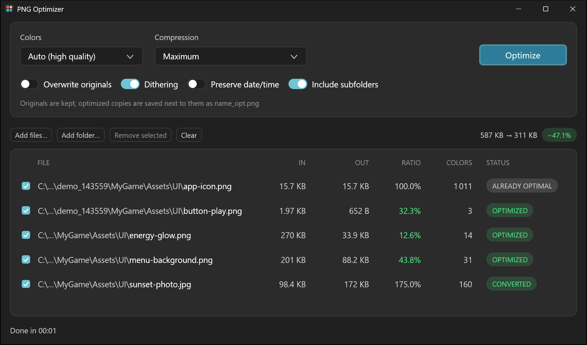

# PNG Optimizer

A fast batch PNG optimizer for Windows. Drop images or whole folders, pick a color mode, press **Optimize**.
Combines lossy palette reduction (libimagequant — the engine behind pngquant) with lossless recompression (oxipng),
and guarantees that transparent pixels stay transparent.



## Features

- **Batch processing** — drag & drop files or folders (subfolders optional); every CPU core works in parallel.
- **Auto color mode** — picks the fewest colors that still reach the chosen quality, separately for each file.
  Flat UI graphics often end up with 10–30 colors, smooth gradients keep up to 256.
- **Fixed palettes** (256 … 2 colors) or **lossless** recompression only.
- **Transparency guarantee** — fully transparent pixels are never turned into barely-visible ones, a common
  artifact of palette quantization. Every result is verified against the original before it is written.
- **Never worse than the original** — if the optimized file isn't smaller, the original is kept.
- **Other formats in** — JPG, GIF, WebP, BMP, TIFF, TGA, ICO and QOI are converted to optimized PNG
  (the source file is kept; JPEG EXIF rotation is applied; animated GIF/WebP use the first frame).
- **Safe by default** — originals are kept and optimized copies are saved as `name_opt.png`;
  switch on *Overwrite originals* to replace files in place.
- Per-file results: size before/after, ratio, actual number of colors, status with explanations on hover.
- Single portable `.exe` — no installer, no runtime, nothing unpacked to disk.
- Native look: follows the Windows light/dark theme and accent color, sharp on high-DPI monitors.

## Download

Get `PNGOptimizer.exe` from the [Releases](../../releases) page and run it. Windows 10/11, x64.

## Settings

| Setting | What it does |
|---|---|
| **Colors → Lossless** | No color reduction, only lossless recompression. Pixel-identical result. |
| **Colors → Auto (high quality / balanced / smaller)** | Fewest colors that reach the quality target (85 / 65 / 40 on pngquant's 0–100 scale). |
| **Colors → 256 … 2** | Fixed palette size. |
| **Compression → Fast** | Quick lossless pass. |
| **Compression → Maximum** | Thorough oxipng search (default). |
| **Compression → Extreme** | Adds Zopfli and keeps whichever is smaller. Much slower, typically 0.3–1 % smaller. |
| **Overwrite originals** | Off: writes `name_opt.png` next to the file. On: replaces the file. |
| **Dithering** | Smoother gradients with few colors; slightly larger files. |
| **Preserve date/time** | Keeps the original file's created/modified timestamps. |
| **Include subfolders** | Scans dropped folders recursively. |

Shortcuts: <kbd>Del</kbd> removes selected rows, <kbd>Ctrl</kbd>+<kbd>A</kbd> selects all,
<kbd>Ctrl</kbd>/<kbd>Shift</kbd>+click work like in Explorer, double-click shows the file in Explorer.

## How it works

1. Decode the image (PNG via lodepng, other formats via `image`).
2. If a color mode is selected, quantize with libimagequant. A fully transparent palette entry is reserved, and any
   pixel that was transparent in the original but became visible is remapped back to it.
3. Recompress losslessly with oxipng (and Zopfli on *Extreme*).
4. Verify the result against the original's transparency. If the check fails, fall back to lossless;
   if that fails too, leave the file untouched.
5. Write atomically (temp file + rename) only if the result is smaller.

## Building from source

Requirements: [Rust](https://rustup.rs) (stable) and the MSVC C++ build tools.

```
winget install Rustlang.Rustup
winget install Microsoft.VisualStudio.2022.BuildTools --override "--wait --passive --add Microsoft.VisualStudio.Workload.VCTools --includeRecommended"
cargo build --release
```

The executable is `target\release\PNGOptimizer.exe` (statically linked C runtime, no DLLs).
Run the tests with `cargo test --release`.

## Credits

Built on excellent open-source work:

- [libimagequant](https://github.com/ImageOptim/libimagequant) by Kornel Lesiński — GPL-3.0-or-later
- [oxipng](https://github.com/shssoichiro/oxipng) — MIT (with [libdeflate](https://github.com/ebiggers/libdeflate) and [Zopfli](https://github.com/google/zopfli))
- [egui / eframe](https://github.com/emilk/egui) and [egui-elegance](https://github.com/matrix-research-inc/egui-elegance) — MIT / Apache-2.0
- [image](https://github.com/image-rs/image) — MIT / Apache-2.0, [lodepng](https://github.com/kornelski/lodepng-rust) — Zlib

## License

[GPL-3.0-or-later](LICENSE). Because the app links libimagequant (GPL-3.0), the application as a whole is
distributed under the GNU GPL v3 or later.
